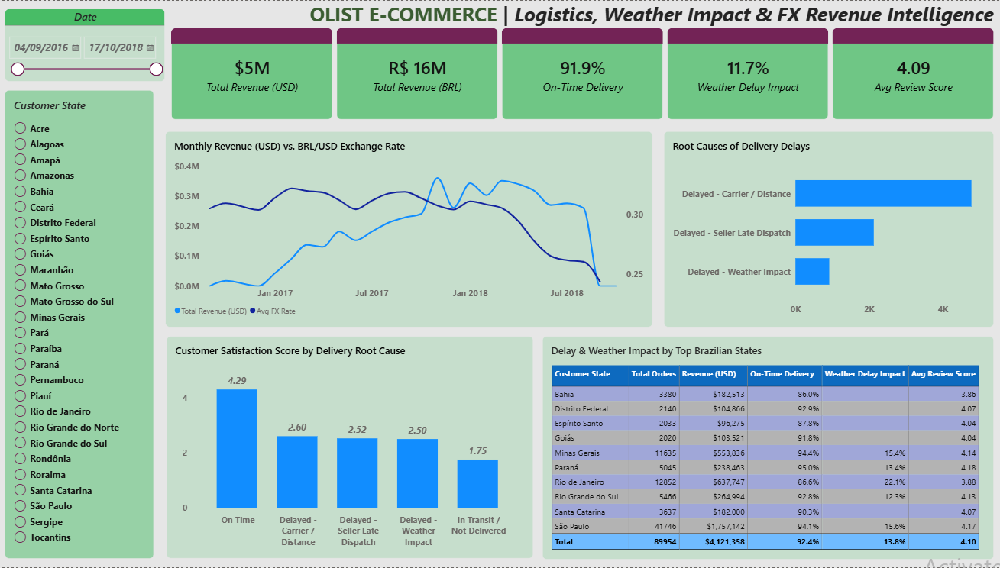
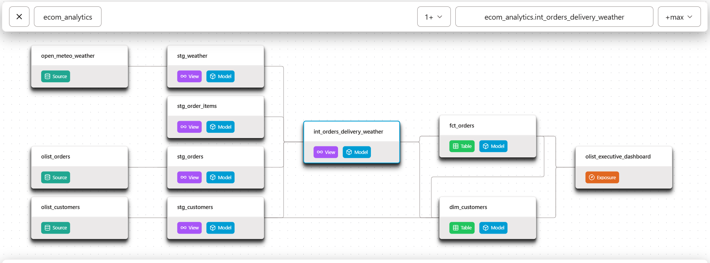
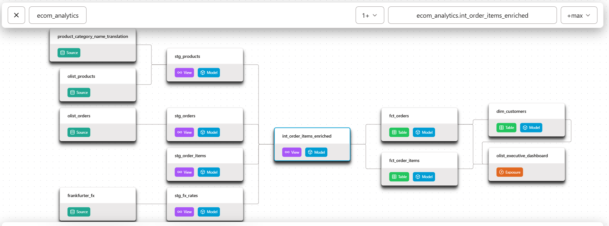
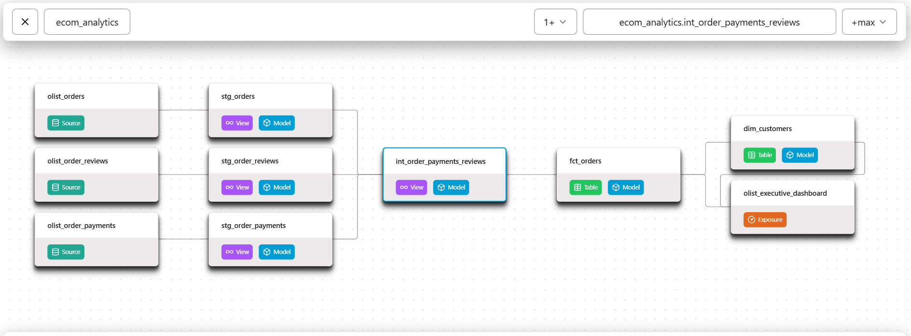

# Olist E-Commerce: Logistics, Weather & FX Analytics

An end-to-end **Analytics Engineering** project built with **Python**, **Google BigQuery**, **dbt**, and **Power BI**. This project combines internal e-commerce sales data with external currency exchange rates and daily weather data to help business leaders make better decisions.

---

## 1. Why This Project Was Built (The Problem)

Olist (a Brazilian e-commerce company) had data stored in different places, making it hard for management to answer three important questions:

1. **Why are orders arriving late?** Management did not know if delays were caused by sellers shipping late, shipping carriers, or **heavy rain** in major cities.
2. **What is the real revenue in USD?** All sales were recorded in Brazilian Real (**BRL**). Management needed to see the exact revenue in **USD** using the exchange rate of the day each order was placed.
3. **Why do customers leave low review scores?** Management needed to measure how much delivery delays and bad weather hurt customer satisfaction (`1–5 stars`).

---

## 2. How We Solved It (The Solution)

We built a complete data pipeline that collects, cleans, joins, and visualizes the data automatically:

* **Step 1: Data Inspection & Ingestion (Python ➔ BigQuery `raw`)**
  * Inspected 9 raw Olist CSV files using **Pandas** (`scripts/data_inspection.py`) to check row counts, missing values, and duplicates.
  * Used Python scripts (`ingestion/`) to fetch historical daily exchange rates (**BRL to USD/EUR**) from **Frankfurter API** and historical weather data (rain and temperature) for top Brazilian cities from **Open-Meteo API**.
* **Step 2: Data Modeling & Quality Tests (dbt ➔ BigQuery `staging`, `intermediate`, `marts`)**
  * **Staging (8 views):** Cleaned column names, fixed date formats, and translated product categories from Portuguese to English.
  * **Intermediate (3 views):** Joined orders with transaction-date exchange rates and delivery-date weather conditions.
  * **Marts (4 tables):** Built a clean **Star Schema** (`fct_orders`, `fct_order_items`, `dim_customers`, `dim_products`) with clear delay reasons (`Seller Late Dispatch`, `Weather Impact`, `Carrier / Distance`, or `On Time`).
  * **Data Quality:** Added **11 automated dbt tests** (`unique`, `not_null`, `accepted_values`) to guarantee clean data.
* **Step 3: Executive Dashboard (Power BI)**
  * Connected **Power BI** to the BigQuery `marts` tables to build a one-page executive report.

---

## 3. Executive Dashboard & Key Findings



* **Currency Impact:** Order volume grew in 2018, but the drop in the **BRL/USD** exchange rate (from `0.30` down to `0.25`) reduced total revenue when measured in USD (**\$5M USD** / **R\$ 16M BRL**).
* **Weather vs. Seller Delays:** **91.9%** of orders arrived on time. Among delayed orders, **11.7%** were caused by rain on the delivery day - reaching **22.1%** in **Rio de Janeiro**.
* **Customer Reviews:** On-time orders received an average rating of **4.29 / 5**, while delayed orders dropped sharply to **2.50 – 2.60 / 5**.

---

## 4. Data Lineage (dbt Pipeline Flow)

To keep the data flow easy to understand, the pipeline is split into three core data streams feeding the final **Power BI Dashboard**:

### A. Orders, Delivery Delays & Weather Stream


### B. Order Items, Products & FX Conversion Stream


### C. Payments & Customer Reviews Stream


---

## 5. Project Folder Structure

```text
ecom-analytics/
├── data/
├── docs/
├── ingestion/
│   ├── frankfurter/
│   └── open_meteo/
├── dbt/
│   ├── macros/
│   └── models/
│       ├── staging/
│       ├── intermediate/
│       └── marts/
├── powerbi/                # Power BI report file (.pbix)
├── scripts/
│   └── data_inspection.py  # Python script for initial data profiling (EDA)
├── .env.example
└── .gitignore
```

---

## 6. How to Run This Project

1. **Set up Python environment:**
   ```bash
   python -m venv venv
   .\venv\Scripts\Activate.ps1
   pip install google-cloud-bigquery pandas pyarrow requests python-dotenv db-dtypes
   ```
2. **Add your Google Cloud credentials:**
   * Copy `.env.example` to `.env` and add your `GCP_PROJECT_ID` and JSON key path.
3. **Run data inspection and API scripts:**
   ```bash
   python scripts/data_inspection.py
   python ingestion/frankfurter/get_fx.py
   python ingestion/open_meteo/get_weather.py
   ```
4. **Run dbt models and tests:**
   ```bash
   cd dbt
   dbt run
   dbt test
   ``` 
---

## 7. Author & Contact

**NDARISHIZE Olivier** - *Analytics Engineer*  
 Location: Rwanda  
 LinkedIn: [Connect with me on LinkedIn](www.linkedin.com/in/ndarishize-olivier-109858421)  
 Email: olivierndarishize85@gmail.com

